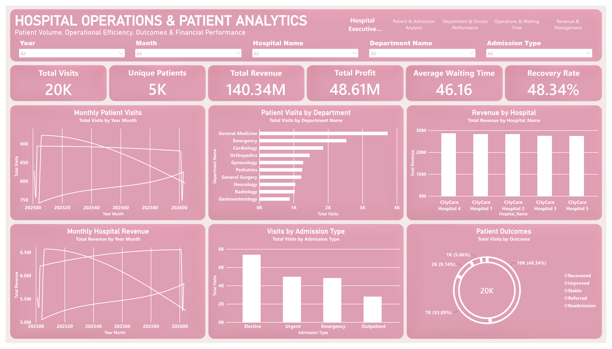
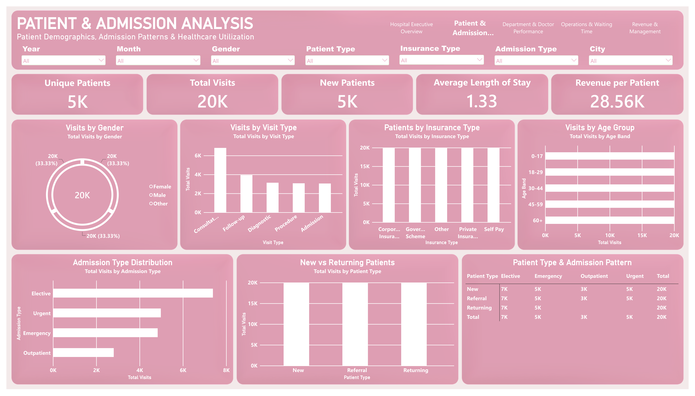
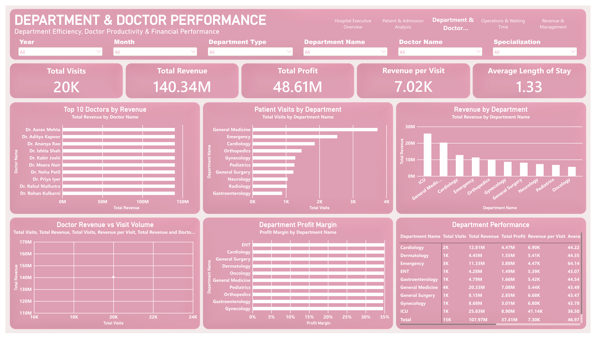
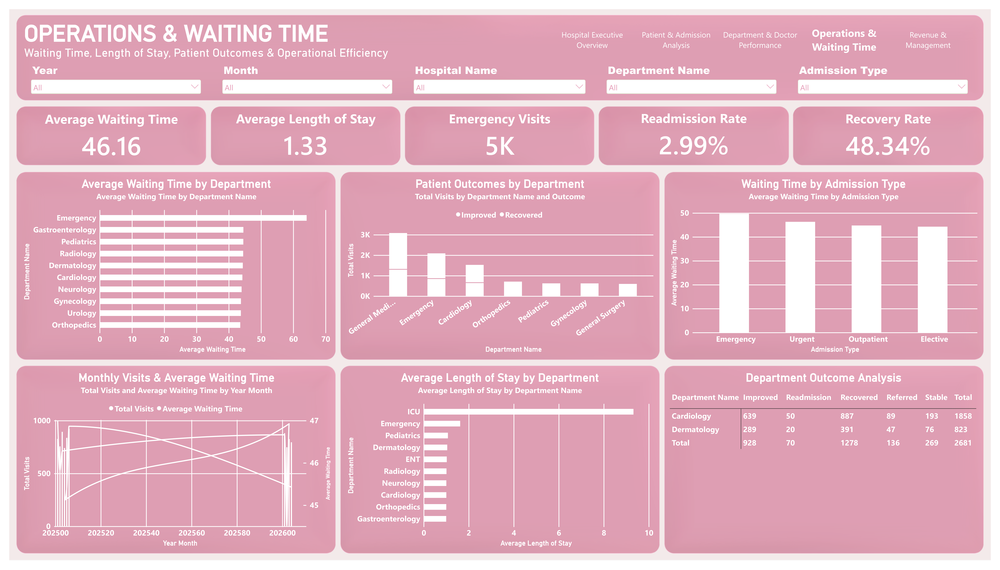
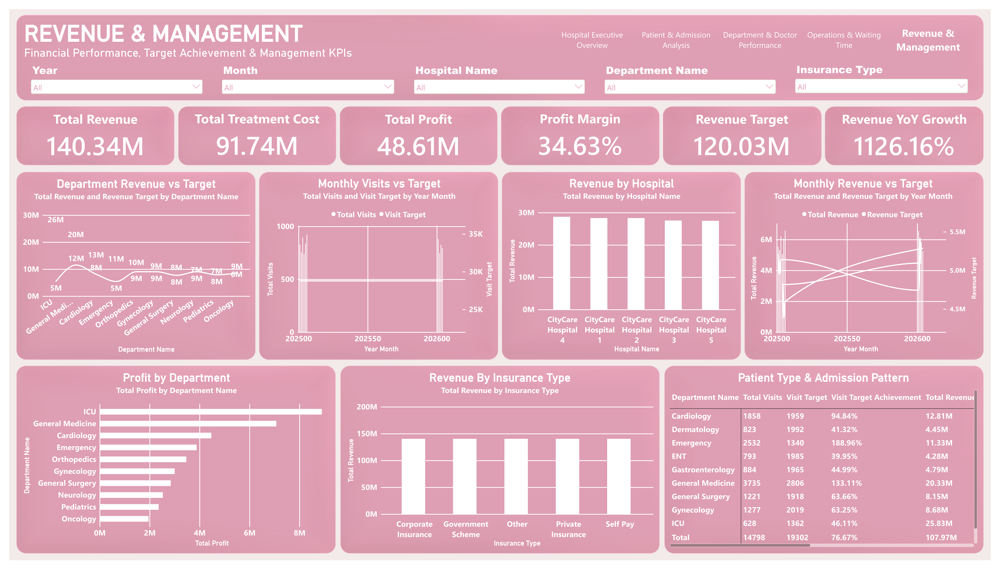

# Hospital Operations & Patient Analytics | Power BI Project

A Power BI healthcare analytics project focused on hospital operations, patient admissions, department and doctor performance, waiting times, patient outcomes, revenue, profitability, and management KPIs.

This project brings multiple healthcare performance indicators into a five-page interactive dashboard to support operational monitoring and data-driven decision-making.

## Project Overview

The **Hospital Operations & Patient Analytics Dashboard** analyzes hospital visit records and supporting dimension tables to explore how patient activity, operational efficiency, clinical outcomes, and financial performance can be monitored in one reporting environment.

The dashboard is built using Microsoft Power BI and an Excel-based synthetic portfolio dataset. It combines patient and admission analysis with department performance, waiting-time monitoring, revenue analysis, and target comparisons.

### Project Objectives

- Monitor hospital visits and unique patient activity.
- Analyze patient demographics, visit types, admission patterns, and insurance categories.
- Compare department and doctor performance using visits, revenue, and profit.
- Examine waiting times, length of stay, readmission, and patient outcomes.
- Track revenue, treatment costs, profit, and reported target achievement.
- Identify data-quality and KPI-definition issues that should be validated before business use.

## Dashboard Pages

### 1. Hospital Operations & Patient Analytics



**Purpose:** Executive overview of hospital activity, operational indicators, patient outcomes, and financial performance.

- Total Visits and Unique Patients
- Total Revenue and Total Profit
- Average Waiting Time and Recovery Rate
- Monthly Patient Visits and Monthly Hospital Revenue
- Patient Visits by Department
- Revenue by Hospital
- Visits by Admission Type and Patient Outcomes

### 2. Patient & Admission Analysis



**Purpose:** Analyze patient demographics, healthcare utilization, and admission patterns.

- Unique Patients, Total Visits, and New Patients
- Average Length of Stay and Revenue per Patient
- Visits by Gender and Age Group
- Visits by Visit Type
- Patients by Insurance Type
- Admission Type Distribution
- New vs Returning Patients
- Patient Type & Admission Pattern

### 3. Department & Doctor Performance



**Purpose:** Compare department activity, doctor revenue, and departmental financial performance.

- Top 10 Doctors by Revenue
- Patient Visits by Department
- Revenue by Department
- Doctor Revenue vs Visit Volume
- Department Profit Margin
- Department Performance table

### 4. Operations & Waiting Time



**Purpose:** Monitor waiting times, length of stay, patient outcomes, and operational indicators.

- Average Waiting Time
- Average Length of Stay
- Emergency Visits
- Readmission Rate and Recovery Rate
- Average Waiting Time by Department
- Waiting Time by Admission Type
- Monthly Visits & Average Waiting Time
- Patient Outcomes by Department
- Department Outcome Analysis

### 5. Revenue & Management



**Purpose:** Review reported financial results and target-oriented performance indicators.

- Total Revenue and Total Treatment Cost
- Total Profit and Profit Margin
- Revenue Target and Revenue YoY Growth
- Department Revenue vs Target
- Monthly Visits vs Target
- Revenue by Hospital
- Profit by Department
- Revenue by Insurance Type
- Patient Type & Admission Pattern table


## Dataset & Excel Workbook

The project uses a **synthetic portfolio dataset** supplied in an Excel workbook. The workbook contains the following sheets:

| Worksheet | Records, excluding header | Purpose |
|---|---:|---|
| `FactVisits` | 20,000 | Hospital visit and operational records |
| `DimPatient` | 5,000 | Patient attributes |
| `DimDoctor` | 105 | Doctor and specialization attributes |
| `DimDepartment` | 15 | Department information |
| `DimHospital` | 5 | Hospital information |
| `DimDate` | 730 | Calendar and date attributes |
| `Targets` | 360 | Target records |
| `Project_Info` | 1 | Project metadata |

The visit fact table supports analysis of admission and visit types, waiting time, length of stay, treatment costs, revenue, payment information, and patient outcomes.

The dimension sheets provide supporting patient, doctor, department, hospital, and date information. The `Targets` sheet supports target-oriented reporting.

> **Dataset note:** This is a synthetic portfolio project, not a report of actual hospital performance or real patient outcomes.

## Key Performance Indicators

The following figures are displayed in the supplied dashboard PDF. They are reported dashboard values and should not be interpreted as independently audited results.

| KPI | Reported value |
|---|---:|
| Total Visits | 20K |
| Unique Patients | 5K |
| Total Revenue | 140.34M |
| Total Profit | 48.61M |
| Average Waiting Time | 46.16 |
| Recovery Rate | 48.34% |
| Average Length of Stay | 1.33 |
| Readmission Rate | 2.99% |
| Total Treatment Cost | 91.74M |
| Profit Margin | 34.63% |
| Revenue Target | 120.03M |
| Revenue YoY Growth | 1,126.16% |

The unit and calculation definition of each KPI should be documented in the Power BI model. In particular, waiting time and length of stay should have clearly stated units.

## Analytical Observations

The dashboard is designed to help users investigate:

- Which departments and hospitals contribute the most visits and revenue.
- How patient volume varies by admission type, visit type, demographics, and insurance.
- How reported revenue and profit differ across departments.
- Where waiting times and length of stay vary between departments or admission categories.
- How reported hospital and department results compare with targets.
- Whether patient outcome categories and readmission measures are consistently defined.

These are analysis areas supported by the dashboard design. Specific performance conclusions should be drawn only after validating the underlying calculations and filters.

## Data Validation & Limitations

A review of the dashboard and workbook identified several items that should be checked before using the reported figures for decision-making:

1. **Date relationship and time intelligence:** Confirm that the fact-table date key matches the date dimension's relationship key. Validate the date relationship before relying on monthly trends or year-over-year calculations.
2. **Revenue YoY growth:** The dashboard displays 1,126.16% growth. This requires validation against the intended comparison period, date filters, and DAX measure.
3. **Different totals across visuals:** Some department-level totals differ from the executive-page totals. Check filter context, category coverage, and aggregation logic before treating these as directly comparable.
4. **Unique patient count:** Confirm that the KPI counts distinct patients represented in visit records rather than all records in the patient dimension.
5. **Target definitions:** Document whether targets are monthly, annual, department-level, or hospital-level, and verify that actuals and targets use comparable periods and filters.
6. **Outcome and operational measures:** Define the denominator and inclusion rules for recovery rate, readmission rate, average waiting time, and length of stay.

The dashboard figures are preserved as displayed in the supplied report. These validation notes identify checks to complete; they do not imply that the measures have already been corrected.

## Tools & Technologies

- **Microsoft Power BI Desktop** — dashboard development and interactive reporting
- **Microsoft Excel** — source workbook and dataset
- **Power Query** — data preparation and transformation, where used
- **DAX** — KPI calculations and measures, where implemented
- **Data modeling** — fact and dimension tables for analytical reporting

## Skills Demonstrated

- Healthcare operations analytics
- Patient and admission analysis
- Department and doctor performance analysis
- KPI reporting and dashboard design
- Revenue, cost, and profitability analysis
- Target monitoring
- Data modeling and metric validation
- Data visualization and business reporting

## Repository Structure

```text
Hospital-Operations-Patient-Analytics-Power-BI/
├── README.md
├── Hospital Operations Analysis.pbix
├── Hospital Operations Analysis.xlsx
└── screenshots/
    ├── hospital-executive-overview.png
    ├── patient-admission-analysis.png
    ├── department-doctor-performance.png
    ├── operations-waiting-time.png
    └── revenue-management.png
```

The screenshot filenames above are the proposed names for the five PDF pages. Add the corresponding PNG files before publishing the repository so the screenshot links can be verified.

## How to Explore the Project

1. Download or clone the repository.
2. Open the `.pbix` file using Microsoft Power BI Desktop.
3. Review the dashboard pages and available slicers.
4. Inspect the Excel workbook to understand the source tables.
5. Validate the data model, measures, date relationships, and target definitions before relying on the reported KPIs.

## Potential Applications

The analytical approach demonstrated in this portfolio project could support hospital management reporting, operational performance reviews, patient-flow monitoring, departmental comparisons, and financial KPI tracking. The synthetic dataset is intended for demonstration and learning, not clinical or operational decision-making.

## Author

**Altamash Nizamuddin**  
Data Analyst | Excel • Power BI • Python • MySQL

- GitHub: [@altamash-analyst](https://github.com/altamash-analyst)
- Email: [altamash9876@gmail.com](mailto:altamash9876@gmail.com)
